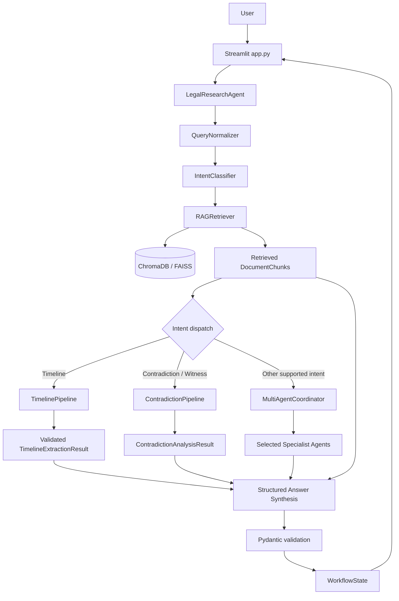
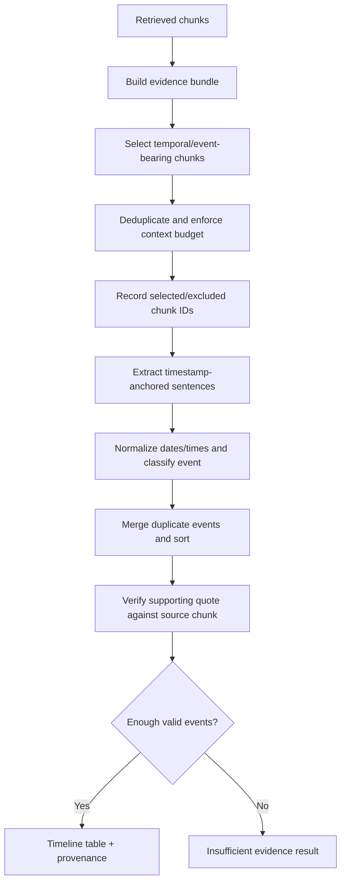
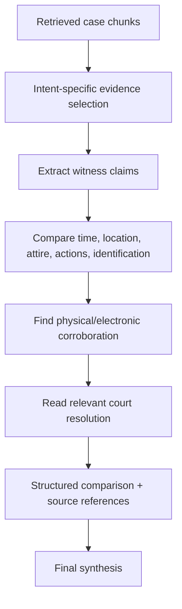

# Crime Scene Investigation RAG

**A source-grounded, multi-agent legal case research assistant** built with Python, Streamlit, LangChain, Pydantic, ChromaDB/FAISS, and configurable LLM providers.

The application ingests case records, retrieves relevant passages, routes a query to focused legal-analysis workflows, and returns structured findings with source references and explicit evidence limitations. Its purpose is legal-document research and investigation support—not autonomous legal decision-making or legal advice.

> **Evidence principle:** retrieved case documents are the primary evidence. Specialist-agent text is supporting analysis, not an independent source. Allegations, witness observations, forensic estimates, defence claims, and judicial findings must remain distinct.

---

## Contents

- [Project overview](#project-overview)
- [Capabilities](#capabilities)
- [Architecture](#architecture)
- [Repository layout](#repository-layout)
- [Experiments and execution guide](#experiments-and-execution-guide)
- [Installation](#installation)
- [Run the application](#run-the-application)
- [Evaluation methodology](#evaluation-methodology)
- [Testing and CI](#testing-and-ci)
- [Configuration](#configuration)
- [Data and persistence](#data-and-persistence)
- [Troubleshooting](#troubleshooting)
- [Limitations and responsible use](#limitations-and-responsible-use)

---

## Project overview

Traditional document search returns passages but leaves users to manually connect dates, compare witness accounts, locate forensic findings, and identify what a court ultimately held. This project combines retrieval-augmented generation (RAG) with intent-aware specialist analysis to make those research tasks more structured and inspectable.

### Core workflow

1. A user uploads case documents or uses the bundled synthetic case records.
2. The document loader extracts text and page/document metadata.
3. A legal-aware splitter creates overlapping evidence chunks.
4. An embedding service represents chunks and queries as vectors.
5. A persistent vector store indexes the chunks.
6. Query normalization and intent classification prepare the user's request.
7. Hybrid retrieval gathers and reranks candidate evidence.
8. The coordinator dispatches timeline, contradiction, case-facts, or evidence analysis as appropriate.
9. Deterministic pipelines build source-linked timeline/contradiction records where those workflows apply.
10. The LLM synthesis path produces a structured legal-research answer.
11. Pydantic models validate the response contract and Streamlit displays findings, citations, workflow diagnostics, and session history.

### Main technologies

| Layer | Technology |
|---|---|
| User interface | Streamlit |
| Application language | Python |
| Agent orchestration | `LegalResearchAgent`, `MultiAgentCoordinator`, LangChain tool interfaces |
| LLM providers | Ollama, Gemini, OpenAI; deterministic local fallback |
| Embeddings | Sentence-Transformers (`all-MiniLM-L6-v2`) by default; optional Gemini/OpenAI embeddings |
| Vector database | ChromaDB by default; optional FAISS CPU backend |
| Structured data | Pydantic |
| Document ingestion | pypdf, python-docx, TXT/text readers |
| Automated checks | pytest, compileall, GitHub Actions |

---

## Capabilities

- **Case-file ingestion:** PDF, DOCX/DOC, TXT, Markdown, and log/text files through the document loader.
- **Legal-aware chunking:** document/page metadata, logical section boundaries, configurable chunk size, and overlap.
- **Hybrid evidence retrieval:** semantic similarity combined with lexical terms and entity/topic boosts, multi-query expansion, deduplication, and document diversity.
- **Query understanding:** normalization, spelling/shorthand handling, ambiguity detection, and intent classification.
- **Intent-specific research:** case summary/facts, accused information, timeline, witness and contradiction analysis, evidence assessment, court findings, and legal-provision research.
- **Structured timeline extraction:** date/time anchors, time ranges, event categories, source chunk/document IDs, supporting quotations, duplicate merging, chronological ordering, and provenance validation.
- **Contradiction analysis:** extracts witness claims, compares factual details, identifies corroborating physical/electronic evidence, and records how the court treated a discrepancy.
- **Multi-agent analysis:** selects focused specialists for the classified intent; specialist failures are recorded without automatically destroying the primary answer path.
- **Evidence-aware output:** Pydantic answer and source schemas, findings, limitations, and source snippets.
- **Retrieval diagnostics:** inspect retrieved passages and evaluate relevance against manually supplied filenames or chunk IDs.
- **Latency comparison:** compare direct LLM generation with the complete RAG workflow.
- **Session history:** inspect prior research outputs within the active Streamlit session.
- **Synthetic demonstration case:** bundled sample records for reproducible local exploration.

---

## Architecture

### High-level system architecture



### Component responsibilities

| Component | Responsibility |
|---|---|
| `app.py` | Streamlit interface, provider selection, file upload/indexing, research, history, and evaluation tabs |
| `LegalResearchAgent` | Owns request lifecycle, normalization, intent classification, retrieval, dispatch, synthesis, validation, and workflow metrics |
| `QueryNormalizer` | Normalizes noisy queries and flags underspecified requests while preserving named entities |
| `IntentClassifier` | Assigns an `IntentType` and confidence using intent patterns and query context |
| `RAGRetriever` | Performs expanded candidate search, hybrid scoring, entity/topic boosts, deduplication, and evidence-strength assessment |
| `VectorStoreManager` | Persists and searches embedded chunks in ChromaDB or optional FAISS |
| `MultiAgentCoordinator` | Selects and invokes relevant specialist agents, records failures, and reconciles specialist outputs against source evidence |
| `TimelinePipeline` | Bundles timeline-relevant chunks, extracts structured events, verifies source support, sorts events, and formats a timeline |
| `ContradictionPipeline` | Extracts witness claims, compares accounts, identifies corroborating evidence, and records court resolution separately |
| `LLMService` | Abstracts configured model/provider inference and structured response generation |
| `models/schemas.py` | Shared intent, chunk, timeline, contradiction, source, answer, tool, and workflow data contracts |

### Agent roles

The application uses a **coordinator-led, intent-routed architecture**. Specialist agents are not independent RAG systems and do not independently index or retrieve their own knowledge bases. They analyze evidence supplied by the coordinator.

| Agent | Typical responsibility |
|---|---|
| Timeline Analysis Agent | Chronology and event attribution |
| Witness & Contradiction Agent | Compare witness statements and identify factual discrepancies |
| Case Facts Agent | Summarize relevant case facts with procedural-role attribution |
| Evidence Assessment Agent | Assess support, corroboration, conflict, and remaining gaps |

The deterministic timeline and contradiction pipelines are separate from free-form specialist prose. The final answer should rely on structured pipeline results and original retrieved passages where those workflows are dispatched.

### Timeline workflow



Timeline records use the `TimelineEvent` schema, including date/time fields, event description, actors, event classification, source chunk/document IDs, supporting quote, certainty, and confidence. The evidence bundle records selected chunks, excluded chunks and reasons, total chunks considered, and context length. The current bundle builder has a configurable 32,000-character default budget; exclusions are recorded in the returned metadata.

### Contradiction workflow



A factual discrepancy and its legal significance are different questions. CCTV or a court's explanation may corroborate one account or explain why a discrepancy was treated as an honest error; it does not make the original statements identical. The pipeline preserves the factual comparison and the judicial treatment as separate fields.

### Retrieval scoring (implementation overview)

The retriever obtains a candidate pool from the vector store, expands selected queries, then combines semantic similarity with lexical/entity signals. The implementation's hybrid score uses a 55% semantic and 45% lexical/entity weighting, followed by deduplication and document-diversity selection. These are implementation weights, not a claim that retrieval quality is 55%/45% or that a benchmark has achieved a specific accuracy.

### Structured response contract

The primary response schema is `LegalResearchAnswer`. It contains the original and normalized query, detected intent, answer, key findings, evidence summary, limitations, cited source models, and optional structured timeline events or contradiction comparisons. Workflow diagnostics are carried by `WorkflowState`.

---

## Repository layout

```text
.
├── app.py                         # Streamlit interface and evaluation tabs
├── config.py                      # Paths and default runtime configuration
├── .env.example                   # Environment variable template
├── requirements.txt               # Main pinned dependency set
├── requirements-faiss.txt         # Optional FAISS dependency
├── agent/
│   ├── legal_research_agent.py    # Main workflow coordinator
│   ├── specialist_agents.py       # Intent-routed specialist agents
│   ├── timeline_pipeline.py       # Structured timeline pipeline
│   ├── contradiction_pipeline.py  # Witness contradiction pipeline
│   └── tools.py                   # Request-scoped LangChain tools
├── llm/
│   └── llm_service.py             # Provider abstraction
├── models/
│   └── schemas.py                 # Pydantic schemas and workflow data models
├── prompts/
│   └── legal_research_prompt.py   # Legal research prompts
├── rag/
│   ├── document_loader.py         # PDF/DOCX/TXT ingestion
│   ├── text_splitter.py           # Legal-aware chunking
│   ├── embeddings.py              # Embedding providers
│   ├── vector_store.py             # ChromaDB / FAISS persistence
│   ├── retriever.py                # Hybrid retrieval
│   ├── evaluation.py               # Labelled retrieval metrics
│   └── benchmark.py                # Direct LLM vs RAG latency comparison
├── utils/
│   ├── query_normalizer.py        # Query cleanup and ambiguity handling
│   └── intent_classifier.py       # Intent classification
├── sample_data/                    # Bundled synthetic case documents
├── tests/                          # Deterministic and regression tests
├── docs/
│   └── MULTI_AGENT_MIGRATION.md   # Multi-agent migration notes
└── .github/workflows/
    └── multi-agent-checks.yml      # Automated syntax and pytest checks
```

---

## Experiments and execution guide

The experiments below describe the implementation and the intended way to run/evaluate each capability. **Automated test success is not the same as a live LLM quality result.** Tests using mocks validate deterministic logic and contracts; live-provider measurements must be run with the selected provider, model, machine, and dataset recorded.

### Experiment 1 — Document ingestion and legal-aware chunking

**Objective:** transform source files into page-aware chunks suitable for retrieval without losing document identity.

**Implementation:** `rag/document_loader.py`, `rag/text_splitter.py`, and the upload/indexing flow in `app.py`.

**Execution:**
1. Start the application (see [Run the application](#run-the-application)).
2. Open **CASE FILES**.
3. Upload one or more PDF, DOCX, or TXT files.
4. Review the ingestion/indexing result and indexed-document/chunk counts.
5. Open **RESEARCH** and inspect retrieved chunk IDs, filenames, page metadata, and excerpts through the diagnostics panels.

**Parameters:** `DEFAULT_CHUNK_SIZE=1000` and `DEFAULT_CHUNK_OVERLAP=150` in `config.py`. These are character-oriented settings, not exact tokenizer token counts.

**What to record:** file type, number of pages extracted, document type, chunk count, chunk size/overlap, page metadata, and whether headings or witness sections remain intelligible across boundaries.

### Experiment 2 — Embeddings and vector-store persistence

**Objective:** represent case passages and queries in a shared vector space and persist searchable chunks.

**Implementation:** `rag/embeddings.py`, `rag/vector_store.py`, and `config.py`.

**Default configuration:** local Sentence-Transformers `all-MiniLM-L6-v2` embeddings and persistent ChromaDB.

**Execution:**
1. Configure `EMBEDDING_PROVIDER=local` and `VECTOR_STORE_BACKEND=chroma`.
2. Upload/index the synthetic case documents or your own allowed case files.
3. Restart Streamlit and verify the document/chunk counts remain present.
4. Run queries against the same indexed data.
5. For an optional FAISS comparison, install the FAISS extra, change the backend setting, and re-index the documents into that backend.

**Important:** ChromaDB and FAISS maintain separate indexes. Re-index when changing backend. Keep the embedding model and vector dimensions consistent for any given index; use a separate data directory when changing embedding dimensions/model.

**What to record:** embedding provider/model, vector backend, indexed chunk count, persistence after restart, retrieval output, hardware, and first-run model-download/cache behavior.

### Experiment 3 — LLM provider integration

**Objective:** support local and hosted language-model execution behind a common service interface.

**Implementation:** `llm/llm_service.py`, `.env.example`, and the provider controls in `app.py`.

**Supported configuration choices:** Ollama, Gemini, OpenAI, and the deterministic `local` fallback. Actual availability depends on the credentials, local service, provider adapter, model name, and network.

**Ollama execution:**
```bash
# In a separate terminal: start Ollama if it is not already running
ollama serve

# Pull the configured model (default shown in .env.example)
ollama pull qwen2.5:1.5b

# Optional connectivity/model check
ollama list
```

Set `LLM_PROVIDER=ollama`, `LLM_MODEL=qwen2.5:1.5b`, and `OLLAMA_BASE_URL=http://localhost:11434` in `.env`, then restart the app.

**Gemini/OpenAI execution:** set `LLM_PROVIDER=gemini` or `openai`, configure the corresponding API key and model/provider settings supported by `llm/llm_service.py`, then restart the application. Never commit credentials.

**What to record:** provider, exact model ID, quantization (where applicable), temperature, API/model version if exposed, machine/hardware, warm-up status, latency, error/fallback state, and output quality. Do not compare provider timings from different hardware/network conditions as if they were controlled experiments.

### Experiment 4 — Query normalization and intent classification

**Objective:** test whether noisy, informal, paraphrased, ambiguous, and out-of-scope requests are normalized and routed to the intended workflow.

**Implementation:** `utils/query_normalizer.py`, `utils/intent_classifier.py`, and the `IntentType` contract in `models/schemas.py`.

**Automated execution:**
```bash
python -m pytest -q tests/test_query_understanding.py
```

The test module also contains a manual evaluation runner that builds a fresh sample index and evaluates its query set:

```bash
python tests/test_query_understanding.py
```

This script uses the deterministic local provider for its workflow and prints an evaluation summary. It rebuilds/clears the configured vector store as part of its setup: back up any local index you need before running it.

**Coverage themes:** correct English, spelling mistakes, grammatical errors, informal phrasing, paraphrases, ambiguous questions, exact entities/dates/legal references, and out-of-domain queries.

**Metrics in the runner:** baseline intent match, improved intent match, retrieval coverage, schema validity, grounding checks, and end-to-end elapsed time. Interpret them only in the context of this bundled test dataset and its expected labels; they are not a general legal-domain benchmark.

### Experiment 5 — Structured answer schema and session workflow

**Objective:** ensure the generated answer is returned in a stable structure that the UI can render and that session history can inspect.

**Implementation:** `models/schemas.py`, `llm/llm_service.py`, and `agent/legal_research_agent.py`.

**Execution:**
```bash
python -m pytest -q tests/test_audit_fixes.py
```

In the application, run a case question, inspect the returned findings, evidence summary, limitations, citations, and workflow diagnostics; then open **HISTORY** to inspect the session record. Clear session history only when desired; it is separate from the persistent vector index.

**What to verify:** required answer fields, valid source objects, coherent limitations, correct intent, source identity/page/chunk details, and no unsupported claim introduced during synthesis.

### Experiment 6 — Multi-agent intent routing

**Objective:** delegate relevant evidence analysis to focused specialists while preserving the primary workflow coordinator and shared retrieved evidence.

**Implementation:** `agent/specialist_agents.py` and `LegalResearchAgent`.

**Automated execution:**
```bash
python -m pytest -q tests/test_multi_agent.py
```

**Manual execution:** start the application with an LLM provider that supports text generation, index the sample case, and try:
- `Give me the timeline of events.`
- `Are there contradictions between the witness statements?`
- `What happened in this case?`
- `What evidence connects the accused to the crime?`

Inspect the workflow progress and agent activity. With the deterministic `local` provider, model-backed specialist reasoning is intentionally marked skipped; the deterministic timeline/contradiction paths remain separate.

**What to record:** query, classified intent/confidence, selected specialists, specialist status, evidence context supplied, errors, total latency, and the final source-grounded answer.

### Experiment 7A — Deterministic timeline extraction

**Objective:** build an ordered, evidence-linked event sequence without relying on the model to invent the chronology.

**Implementation:** `agent/timeline_pipeline.py`, `TimelineEvent` and `TimelineExtractionResult` in `models/schemas.py`, and timeline dispatch in `agent/legal_research_agent.py`.

**Automated execution:**
```bash
python -m pytest -q tests/test_deterministic_workflows.py
python -m pytest -q tests/test_audit_fixes.py -k timeline
```

**Manual execution:**
1. Index the bundled synthetic case documents or a permitted test case.
2. Run `Give me the timeline of events.` in **RESEARCH**.
3. Inspect the timeline table and source citations.
4. Inspect the workflow/tool diagnostics for selected chunk IDs, document IDs, selected count, evidence character count, excluded chunk IDs, and exclusion reasons.
5. Check that time windows remain estimates, event types retain their procedural/source classification, and undated procedural events are not assigned invented timestamps.

**Implemented checks/behaviors:** temporal marker extraction, event category assignment, date/time normalization, ranges and approximate times, deduplication across overlapping chunks, chronological sorting, source quote verification, malformed-fragment rejection, evidence-budget accounting, and insufficient-result reporting.

**Important implementation boundary:** event extraction is currently deterministic rule/pattern-based over retrieved chunks; it is not a general-purpose legal event understanding model. Its source selection is bounded by retrieval results and the timeline bundle's context budget. Review the selected/excluded evidence metadata whenever the timeline appears incomplete.

### Experiment 7B — Witness contradiction analysis

**Objective:** compare actual witness claims and keep factual discrepancies distinct from corroboration and judicial resolution.

**Implementation:** `agent/contradiction_pipeline.py`, `WitnessClaim`, `ContradictionComparison`, and `ContradictionAnalysisResult`.

**Automated execution:**
```bash
python -m pytest -q tests/test_deterministic_workflows.py -k contradiction
python -m pytest -q tests/test_audit_fixes.py -k contradiction
python -m pytest -q tests/test_session_scoped_tools.py
```

**Manual execution:** run `Are there contradictions between the witness statements?` and inspect the two claims, source references, factual discrepancy, corroborating evidence, court resolution, and materiality assessment.

**What to verify:** each claim is assigned to the correct speaker/source; the compared subject is explicit (time, location, attire, action, identification); independent evidence is not confused with testimony; and an explanation by the court does not erase the existence of differing statements.

### Experiment 8 — Retrieval evaluation and ranking quality

**Objective:** measure retrieval against human-verified relevance labels rather than treating similarity scores as ground truth.

**Implementation:** `rag/evaluation.py` and the **RAG EVALUATION** tab in `app.py`.

**Automated execution:**
```bash
python -m pytest -q tests/test_rag_evaluation.py tests/test_vector_store_backends.py
```

**Interactive execution:**
1. Open **RAG EVALUATION**.
2. Enter an evaluation query.
3. Enter manually verified relevant filenames and/or chunk IDs.
4. Select **Evaluate Retrieval**.
5. Inspect the retrieved passages and reported metrics.

**Bundled sample execution:** select **Run Sample Benchmark**. This evaluates the starter labelled synthetic-case queries, including one out-of-scope query with no relevant document label.

**Metrics:**
- Precision@K — fraction of retrieved top-K passages judged relevant.
- Recall@K — fraction of supplied relevant labels retrieved.
- F1@K — harmonic mean of precision and recall.
- Hit rate — whether at least one relevant passage was retrieved.
- Reciprocal rank — reciprocal rank of the first relevant result (MRR when averaged over queries).
- Mean retrieval score and retrieval latency — diagnostics, not relevance ground truth.

Document-level labels mark a retrieved chunk relevant when its normalized document name matches a labelled filename. Chunk-level labels match exact chunk IDs. If both are supplied, a hit occurs when either label matches.

**Protocol for a defensible comparison:** prepare one fixed query set, manually label relevant documents/chunks before comparing variants, keep the same corpus and embedding model, use the same K, record configuration and run date, and compare aggregate plus per-query metrics. Do not tune and report on the same labels without disclosing that they were used for tuning.

### Experiment 9 — Direct LLM versus RAG latency comparison

**Objective:** show the difference between answering from model prior knowledge and executing the complete retrieval-grounded workflow.

**Implementation:** `rag/benchmark.py` and the **Compare LLM-only vs RAG** control in **RAG EVALUATION**.

**Automated execution:**
```bash
python -m pytest -q tests/test_rag_benchmark.py
```

**Interactive execution:** select a non-empty query in **RAG EVALUATION**, choose an LLM provider (not deterministic `local` fallback), and click **Compare LLM-only vs RAG**.

The report shows both answers, direct-model latency, total RAG workflow latency, retrieval-only latency, retrieved passage count, cited source count, evidence strength, and workflow status.

**Interpretation:** this is a single-query diagnostic comparison, not a controlled statistical result and not an answer-quality metric. Repeat multiple runs, separate cold-start from warm runs, alternate run order if practical, and report median/dispersion alongside the provider/model/hardware. The RAG and LLM-only answers have different evidence access by design.

### Experiment 10 — End-to-end workflow and regression safety

**Objective:** verify that timeline, contradiction, summary, evidence, insufficient-evidence, hypothetical, and out-of-scope paths coexist without regressions.

**Focused execution:**
```bash
python -m pytest -q tests/test_multi_agent.py
python -m pytest -q tests/test_deterministic_workflows.py
python -m pytest -q tests/test_audit_fixes.py
python -m pytest -q tests/test_session_scoped_tools.py
```

**Full execution:**
```bash
python -m pytest -q tests
python -m compileall -q .
```

The test files use deterministic fixtures/mocks for core behavior. They do not require a running Ollama daemon or live Gemini/OpenAI calls for the unit-level checks. A separate manual run is still required to validate your chosen local model, model response quality, UI behavior, and local vector index.

---

## Installation

### Prerequisites

- Python 3.11 is the version used by the repository's GitHub Actions workflow.
- Git.
- A compatible environment for the pinned packages in `requirements.txt`.
- Optional: Ollama and a locally pulled model, or API credentials for Gemini/OpenAI.
- Optional: FAISS CPU if you want to use the FAISS backend.

### Clone and create an environment

```bash
git clone https://github.com/SathOps/Crime-Scene-Investigation-RAG.git
cd Crime-Scene-Investigation-RAG

python3.11 -m venv .venv

# macOS / Linux
source .venv/bin/activate

# Windows PowerShell
# .venv\Scripts\Activate.ps1

python -m pip install --upgrade pip
python -m pip install -r requirements.txt
```

The requirements file is pinned. If installation fails on a particular OS/Python version, inspect the failing package's platform/Python support rather than randomly upgrading the whole dependency set.

### Configure environment

```bash
cp .env.example .env
```

Edit `.env` for your provider, model, embedding provider, and vector backend. The example file documents the environment variables used by this repository. Keep the real `.env` out of version control.

### Optional FAISS install

```bash
python -m pip install -r requirements-faiss.txt
```

Then set `VECTOR_STORE_BACKEND=faiss` in `.env` and re-index the intended documents. ChromaDB remains the default.

---

## Run the application

### Start Ollama (only when using Ollama)

In a separate terminal:

```bash
ollama serve
ollama pull qwen2.5:1.5b
ollama list
```

Confirm that the model name in `.env` matches an installed model. If Ollama is already running as a background service, do not start a second server process.

### Launch Streamlit

From the repository root, with the virtual environment activated:

```bash
streamlit run app.py
```

Open the local URL printed by Streamlit (normally `http://localhost:8501`).

### First-run demonstration

1. Confirm the chosen provider is ready.
2. Use **Load Pre-packaged Synthetic Case Files** if the app offers the bundled-case shortcut, or upload the files in `sample_data/` from **CASE FILES**.
3. Verify that the document and indexed chunk counts are non-zero.
4. Open **RESEARCH** and run one of the built-in prompts.
5. Inspect findings, source citations, evidence limitations, and workflow/tool diagnostics.
6. Open **RAG EVALUATION** to run the labelled sample benchmark.

The bundled records are synthetic demonstration material. Do not interpret them as a real criminal case or use them to make decisions about an actual person.

---

## Evaluation methodology

Use the following result table when recording a run. Include raw output or exported screenshots/logs for traceability.

| Field | Record |
|---|---|
| Run ID / date | Unique identifier and local date |
| Git revision | Commit SHA and branch |
| Dataset | Corpus name/version and number of documents/chunks |
| Query set | Fixed list/version of queries |
| Labels | Relevant file/chunk labels and label-review method |
| LLM | Provider, exact model ID/version, generation settings |
| Embeddings | Provider and model |
| Vector store | ChromaDB or FAISS; index state |
| Retrieval | K, thresholds/configuration, selected chunks |
| Metrics | Precision@K, Recall@K, F1@K, hit rate, MRR, latency |
| Workflow | Intent, specialists/dispatch path, tool status |
| Grounding | Citation integrity, unsupported claims, limitations |
| Environment | Python, OS, CPU/GPU/RAM, network/cold-warm status |

### Recommended experiment sequence

1. **Establish a baseline:** freeze the corpus, query list, labels, and configuration.
2. **Run deterministic tests:** run the focused unit/regression suites and full pytest suite.
3. **Run retrieval benchmark:** record per-query hits and aggregate ranking metrics.
4. **Run workflow examples:** execute one representative query per supported intent and inspect source grounding.
5. **Run live model comparisons:** repeat each query several times and separate cold/warm timings.
6. **Review failure cases:** classify failures as ingestion, chunking, retrieval, intent, evidence selection, extraction, synthesis, or UI issues.
7. **Report limitations:** include failed queries and excluded evidence; do not report only successful examples.

### Reporting claims responsibly

The repository contains a query-understanding evaluation runner and labelled retrieval benchmark utilities. Results from those tools are specific to the bundled synthetic corpus, labels, test queries, and selected local environment. Do not reuse historical README percentages as current results unless you re-run the experiment from a clean, documented revision and preserve its output.

---

## Testing and CI

Run the full local verification from the repository root:

```bash
python -m pytest -q tests
python -m compileall -q .
```

Useful focused commands:

```bash
# Multi-agent dispatch, specialist behavior, and failure handling
python -m pytest -q tests/test_multi_agent.py

# Timeline, contradiction, and workflow integration
python -m pytest -q tests/test_deterministic_workflows.py

# Audit/regression cases, evidence selection, provenance, and validation
python -m pytest -q tests/test_audit_fixes.py

# Query normalization and intent evaluation
python -m pytest -q tests/test_query_understanding.py

# Retrieval ranking and benchmark utilities
python -m pytest -q tests/test_rag_evaluation.py tests/test_rag_benchmark.py

# Request-scoped tools and vector-store backends
python -m pytest -q tests/test_session_scoped_tools.py tests/test_vector_store_backends.py

# Workflow metrics
python -m pytest -q tests/test_workflow_metrics.py
```

GitHub Actions workflow: `.github/workflows/multi-agent-checks.yml`. It checks out the repository, sets up Python 3.11, installs lightweight test dependencies, compiles the project modules, and runs `python -m pytest -q tests` on its configured branch/pull-request events.

A passing CI run validates the tests included in that run. It does not prove that a live hosted API, local Ollama model, full Streamlit browser interaction, or arbitrary user-supplied case corpus works correctly.

---

## Configuration

The main configuration is loaded from `.env` (see [`.env.example`](.env.example)).

| Variable | Purpose | Example/default |
|---|---|---|
| `LLM_PROVIDER` | Answer-generation provider | `ollama` |
| `LLM_MODEL` | Configured model identifier | `qwen2.5:1.5b` |
| `OLLAMA_BASE_URL` | Ollama server endpoint | `http://localhost:11434` |
| `OLLAMA_MODEL` | Local Ollama model | `qwen2.5:1.5b` |
| `EMBEDDING_PROVIDER` | Embedding provider | `local` |
| `VECTOR_STORE_BACKEND` | Vector index implementation | `chroma` |
| `GEMINI_API_KEY` | Gemini credential | Secret; do not commit |
| `OPENAI_API_KEY` | OpenAI credential | Secret; do not commit |

Other defaults, including chunk size, overlap, top-K, and storage directories, are set in `config.py`.

---

## Data and persistence

- Uploaded/indexed documents and vector index data are stored under the configured project `data/` directories.
- ChromaDB is the default persistent backend.
- FAISS uses its index/record files under the configured vector-store directory.
- Session history is held in Streamlit session state and is not the vector index.
- Re-index after changing embedding model or vector backend.
- Treat case files, index artifacts, API keys, and exported results as potentially sensitive. The repository's `.gitignore` should be reviewed before adding any local data to a commit.

Do not upload confidential case material to a hosted LLM or embedding provider unless you have authorization and have reviewed the provider's data handling terms.

---

## Troubleshooting

| Symptom | Checks |
|---|---|
| Ollama health check fails | Confirm `ollama serve` is running, `OLLAMA_BASE_URL` is correct, and the configured model appears in `ollama list`. |
| Ollama responds but Streamlit appears stuck | Inspect the Streamlit terminal for the active stage; check embedding model initialization/download, first vector-store access, and provider inference separately. Use workflow progress/diagnostics to identify the stage. |
| No case evidence is retrieved | Confirm documents are indexed, vector-store backend matches the index, embedding provider/model is consistent, and query terms correspond to the corpus. |
| FAISS selected but import fails | Install `requirements-faiss.txt` and confirm the package supports your Python/OS combination. |
| Empty or partial timeline | Inspect retrieved chunks and timeline bundle selected/excluded IDs; confirm relevant dated passages made it through top-K retrieval and the context budget. Rule-based date/time extraction cannot recover evidence that retrieval never returned. |
| Contradiction analysis misses a witness | Inspect selected evidence chunk IDs and document labels; ensure actual witness statements are indexed and retrieved, rather than relying on an alibi passage or summary. |
| Provider/API failure | Verify provider selection, model identifier, credentials, API access, and rate limits; check the Streamlit terminal for the underlying error. |
| Dependency installation fails | Use the repository's Python 3.11 CI version as a baseline and inspect the specific package's compatibility constraints. |

---

## Limitations and responsible use

- This is a research prototype and not a legal-advice system, legal authority, or substitute for a qualified lawyer.
- The system can only retrieve and reason over documents that were ingested and indexed; missing, low-quality, scanned, or poorly extracted source text can lead to incomplete results.
- Retrieval is bounded by top-K and ranking behavior. Evidence absent from retrieved chunks cannot be relied on by downstream analysis.
- The timeline pipeline uses deterministic temporal patterns and sentence extraction. Unusual date formats, implicit chronology, cross-document date inheritance, and complex narratives may require human review.
- The current timeline evidence bundle uses a character budget and reports exclusions; users should inspect the metadata when a timeline may be incomplete.
- Contradiction detection depends on the available witness/source passages and deterministic comparison rules. It may miss nuanced semantic conflicts or identify apparent differences that require context.
- Specialist-agent responses are LLM-generated supporting analyses and may be incomplete or wrong. They are not primary evidence.
- Hosted provider behavior, output quality, latency, availability, and pricing can change independently of this repository.
- Synthetic sample records are for software testing and demonstration only.
- Always verify every consequential finding against the original document and page before relying on it.

---

## Project links

- **Repository:** [SathOps/Crime-Scene-Investigation-RAG](https://github.com/SathOps/Crime-Scene-Investigation-RAG)
- **Multi-agent migration notes:** [docs/MULTI_AGENT_MIGRATION.md](docs/MULTI_AGENT_MIGRATION.md)

## License

No license file was present in the reviewed repository tree at the time this README was updated. Unless a license is added, do not assume that the source code is licensed for unrestricted reuse.
