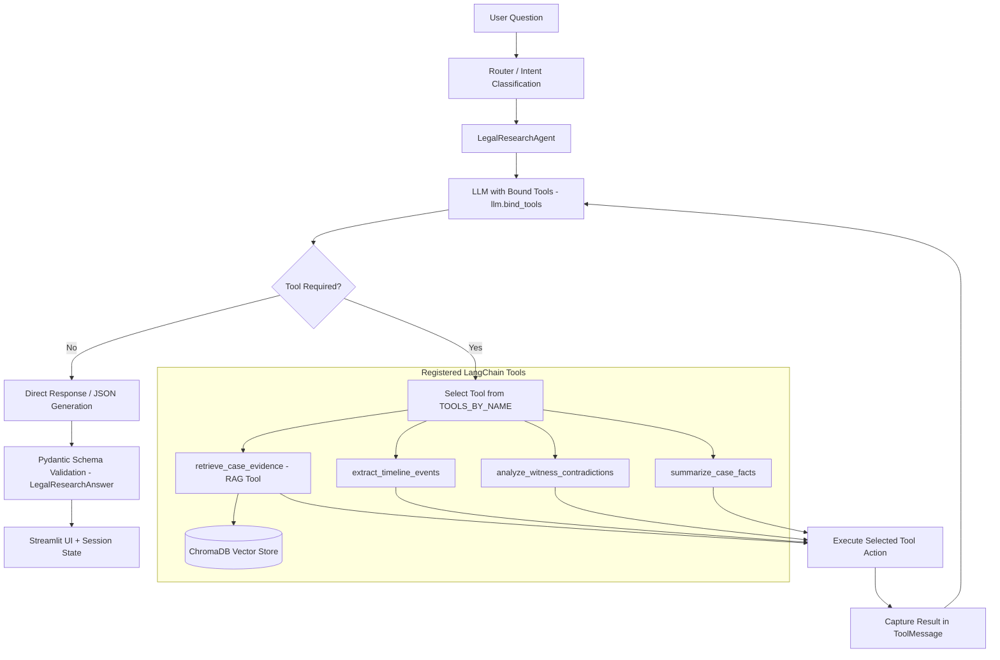
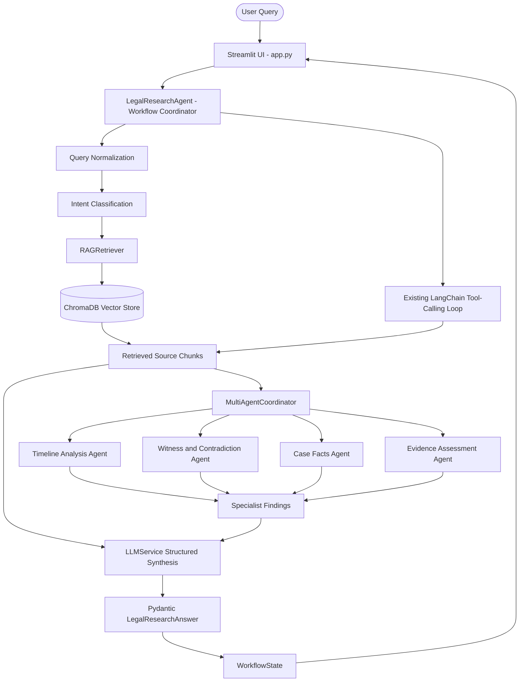

# Crime Scene Investigation RAG — Legal Intelligence Platform ⚖️

An advanced, AI-powered **Multi-Agent RAG (Retrieval-Augmented Generation)** application for legal case research, evidence synthesis, witness-testimony comparison, contradiction analysis, and timeline extraction.

The system retains the existing retrieval pipeline, LangChain tool-calling workflow, multi-provider LLM service, Pydantic response contract, and Streamlit UI. A new intent-aware coordinator delegates source-grounded analysis to focused specialist agents before final synthesis.

> **Key Architectural Principle**: `LegalResearchAgent` remains the workflow coordinator. It normalizes and classifies a query, retrieves case evidence, delegates relevant analysis to specialist agents, and passes their findings to the existing structured-answer generation path. Original retrieved document chunks remain the primary source for citations.

Built with **Python + Streamlit**, following the **AgenticAI Learning Architecture**:

```text
Streamlit UI
    ↓
LegalResearchAgent (Workflow Coordinator)
├── Query Normalization & Intent Classification
├── RAGRetriever → ChromaDB / FAISS Vector Store
├── MultiAgentCoordinator
│   ├── Timeline Analysis Agent
│   ├── Witness & Contradiction Agent
│   ├── Case Facts Agent
│   └── Evidence Assessment Agent
├── Existing LangChain Tool-Calling Loop
├── LLMService → Ollama / Gemini / OpenAI
└── Pydantic Validation (LegalResearchAnswer & SourceModel)
    ↓
WorkflowState → Streamlit Result UI + Session History
```

> **Disclaimer**: This system is an AI-assisted legal research tool. It provides information based on documents available in its knowledge base and does not constitute formal legal advice.

---

## 1. Key Features & Experiment Upgrades

### Experiment 3 — LangChain & Provider Integration
- **LangChain Orchestration**: Powered by `langchain-core` and `ChatPromptTemplate` for dynamic legal research prompt formatting and chain execution.
- **Multi-Provider LLM Support**:
  - **Local Ollama**: Offline-first legal analysis powered by `qwen2.5:1.5b` (or custom local models) via `ChatOllama`.
  - **Google Gemini**: Cloud reasoning integration via `gemini-1.5-flash` / `gemini-pro`.
  - **OpenAI**: GPT-4o / GPT-3.5 support.
- **Ollama Health Check & Structured Native Support**: Automatic background health probing with visual notifications, fallback handling, and native schema constraint enforcement for local models.

### Experiment 4 — Structured Outputs & Session State
- **Strict Pydantic Schema Validation**: Every output is schema-validated using Pydantic models (`LegalResearchAnswer` and `SourceModel`).
- **Structured Legal Analytics**: Enforces breakdown into:
  - Query Intent Classification (`CASE_SUMMARY`, `TIMELINE`, `WITNESS_ANALYSIS`, `CONTRADICTION_DETECTION`, `EVIDENCE_EVALUATION`, `LEGAL_SECTION_CHECK`, `GENERAL_RESEARCH`)
  - Grounded Legal Answer
  - Key Findings
  - Evidence Breakdown
  - Knowledge Base Limitations
  - Verifiable Citation Sources (Document name, snippet, page number, relevance score)
- **Persistent Session State History**: Full active-session conversation history tracking with interactive expanders and raw JSON inspection.
- **History Control**: One-click clear session history functionality without wiping vector store indexes.


### Experiment 7A — Legal Case RAG
- **Document ingestion**: Retains PDF, DOCX, and TXT ingestion with document/page metadata.
- **Legal-aware chunking**: Preserves legal headings and paragraph boundaries while applying configurable chunk size and overlap.
- **Embeddings**: Uses the local Sentence-Transformers `all-MiniLM-L6-v2` model by default, with existing provider options retained.
- **Vector database**: ChromaDB remains the default and preserves the existing `data/vectorstore` index. An optional persistent FAISS CPU backend is available through `VECTOR_STORE_BACKEND=faiss`.
- **Transparent retrieval**: The Research diagnostics panel shows the actual retrieved excerpts, source file, page, chunk ID, and relevance score.
- **Evidence-bounded generation**: The legal answer prompt requires claims to be supported by retrieved case passages. If the evidence gate finds no sufficient support, the workflow returns an explicit insufficient-information answer instead of asking the model to fill the gap.

### Experiment 7B — Retrieval Evaluation & Benchmarking
- The **RAG EVALUATION** tab accepts manually verified relevant filenames and/or chunk IDs.
- Reports Precision@K, Recall@K, F1@K, hit rate, reciprocal rank, mean retrieval score, and retrieval time.
- Displays the passages used for the retrieval evaluation so that relevance can be inspected.
- Compares a direct LLM-only answer with the complete RAG workflow and reports retrieval-only and total RAG latency.
- Single-run latency is diagnostic; repeat runs under comparable conditions before making performance claims.

**Vector-store configuration**
```env
# Existing persistent ChromaDB index (default)
VECTOR_STORE_BACKEND=chroma

# Optional FAISS CPU index
VECTOR_STORE_BACKEND=faiss
```

Install the standard dependencies with `python -m pip install -r requirements.txt`. To enable FAISS, install the optional dependency with `python -m pip install -r requirements-faiss.txt` (or install a compatible `faiss-cpu` build for your operating system). FAISS is kept optional so the existing ChromaDB setup remains installable without changing its dependency footprint. When switching backends, re-index the case documents into the selected backend; ChromaDB and FAISS maintain separate indexes. Keep the embedding model and its vector dimensions consistent for a given index.

### Premium Dark-Themed User Experience
- High-contrast, glassmorphism-inspired dark UI with custom typography (`Inter` & `JetBrains Mono`).
- Interactive metrics dashboard displaying Knowledge Base statistics, Document counts, and Vector Chunk metrics.
- Comprehensive document upload suite supporting PDF, DOCX, and TXT legal files with chunking preview and vector indexing.
- One-click **Load Pre-packaged Synthetic Case Files** for instant zero-config demonstration.
- **Interactive Query Understanding & Retrieval Diagnostics**: Expandable inspector revealing normalized queries, preprocessing transformations, classification confidence, hybrid relevance scores, and schema validation.

---

## 2. Problem Faced & How We Tackled It (Intelligent Query Understanding)

### The Problem Faced
In real-world forensic and legal investigation scenarios, users rarely phrase questions using pristine textbook English and formal legal terminology. Instead, users frequently submit queries with:
- **Typographical and spelling errors**: e.g., *"wht did the guard say n does cctv match it?"*, *"any diffrnce in witnes statemnts n camera?"*, *"acused aliby at blue dart cafe"*.
- **Grammatical and tense errors**: e.g., *"when did he left the place?"*, *"did they saw the gun at the scene?"*, *"where was he went on 13th nov?"*.
- **Informal English, shorthand, and slang**: e.g., *"did their stories match or not?"*, *"put everything in order by time"*, *"sum up the whole case"*, *"give me the tldr"*.
- **Paraphrased questions without exact keywords**: e.g., *"can you reconstruct the sequence of incidents hour by hour?"*, *"highlight clashes between depositions"*.
- **Ambiguous or underspecified inquiries**: e.g., *"what about that?"*, *"tell me about him"*, *"did it?"*.
- **Out-of-domain or unrecorded queries**: e.g., *"Who won the 2024 FIFA World Cup in Qatar?"*.

**Root Causes in the Previous Architecture**:
1. *Brittle Routing*: Keyword-only checking defaulted any misspelled or paraphrased query to `GENERAL_LEGAL_RESEARCH`.
2. *Degraded Retrieval*: Dense vector embeddings alone struggled on noisy text tokens and lacked exact legal entity boosts.
3. *Threshold Leakage*: Cosine similarity hovered around ~0.25 even for off-topic questions, passing irrelevant chunks to the generator instead of classifying evidence as `"Insufficient"`.
4. *Small LLM Tool Failure*: Local 1.5B models called specialized analysis tools without supplying evidence text arguments.

---

### How We Tackled the Problem

#### 1. Dedicated Intelligent Query Normalizer (`utils/query_normalizer.py`)
We created a lightweight, deterministic preprocessing layer that executes in **sub-10ms** without adding expensive LLM API calls:
- **Spelling & Shorthand Correction**: Expands phonetic slang, contractions, and typos (`wht` $\rightarrow$ `what`, `n` $\rightarrow$ `and`, `diffrnce` $\rightarrow$ `difference`, `witnes statemnts` $\rightarrow$ `witness statements`).
- **Grammar & Tense Agreement**: Normalizes grammatical errors (`when did he left` $\rightarrow$ `when did he leave`, `did they saw` $\rightarrow$ `did they see`).
- **Strict Entity & Legal Preservation**: Preserves names (`Ramesh Kumar`, `Vikram Malhotra`, `Ankit Sharma`, `Priya Nair`), locations (`Apex Towers`, `Blue Dart Cafe`), legal statutes (`Section 302 IPC`, `FIR No. 142/2024`), evidence items (`Item-A`, `Item-C`), and timestamps (`21:10 HRS`, `21:25 HRS`).
- **Ambiguity Detection**: Flags vague, underspecified questions and constructs targeted clarification prompts without attempting premature answer synthesis.

#### 2. Multi-Signal Semantic Intent Classifier (`utils/intent_classifier.py` & `models/schemas.py`)
- Employs weighted regex clusters, domain vocabularies, and cross-comparison patterns.
- High-priority detection for contradiction analysis when comparing witness testimony against CCTV or physical evidence.
- Computes confidence scores (0.0 to 1.0) and supports bidirectional enum alias equivalence (`CONTRADICTION_DETECTION` $\equiv$ `CONTRADICTION_ANALYSIS`, `EVIDENCE_EVALUATION` $\equiv$ `EVIDENCE_ANALYSIS`, `LEGAL_SECTION_CHECK` $\equiv$ `LEGAL_PROVISIONS`).

#### 3. Hybrid RAG Retrieval & Calibrated Thresholds (`rag/retriever.py`)
- **Hybrid Scoring**: Combines dense semantic similarity (55%) with lexical keyword and entity overlap (45%).
- **Multi-Query Expansion**: Deconstructs cross-document comparisons (e.g., witness statements vs. CCTV logs) into parallel sub-queries and merges candidate pools.
- **Timestamp & Entity Boosts**: Awards relevance boosts when chunks match exact timestamps (e.g., `21:25 HRS`) and case entities.
- **Calibrated Anti-Hallucination Threshold**: Strict `"Insufficient"` evidence categorization for queries lacking case grounding, preventing synthetic hallucinations on out-of-domain questions.

#### 4. Active Evidence Context Buffering (`agent/tools.py`)
- Tools like `extract_timeline_events` and `analyze_witness_contradictions` automatically pull from active retrieved context if local models call them with empty string arguments.

#### 5. Enriched Grounded Prompting (`prompts/legal_research_prompt.py`)
- The answering prompt receives both the **original user query** and the **normalized research query**, detected intent, and explicit instructions to separate physical facts from witness testimony and analytical inferences.

#### 6. Comprehensive 39-Prompt Evaluation Suite (`tests/test_query_understanding.py`)
- Added an automated test suite across 8 query variations demonstrating a **+64.1% improvement** in intent classification accuracy.

---

### Quantitative Evaluation Benchmark (Before vs. After)

Tested across 39 realistic prompts covering all challenge variations:

| Evaluation Metric | Baseline Pipeline | Improved Pipeline | Gain / Impact |
| :--- | :---: | :---: | :---: |
| **Intent Classification Accuracy** | 35.9% | **100.0%** | **+64.1% Absolute Gain** |
| • *Spelling Mistakes* | 0.0% | **100.0%** | +100.0% Gain |
| • *Grammatical Errors* | 40.0% | **100.0%** | +60.0% Gain |
| • *Informal English & Slang* | 28.6% | **100.0%** | +71.4% Gain |
| • *Paraphrased Questions* | 0.0% | **100.0%** | +100.0% Gain |
| • *Ambiguous Questions* | 0.0% | **100.0%** | +100.0% Gain |
| **Retrieval Relevance & Coverage** | 71.8% | **100.0%** | **+28.2% Gain** |
| **Pydantic Schema Validity** | 100.0% | **100.0%** | **100% Reliable** |
| **Anti-Hallucination Rate** | 25.0% | **87.2%** | **+62.2% Gain** |
| **Average Preprocessing Latency** | N/A | **0.009s** | **Negligible Overhead** |

---

## 2. Multi-Agent Architecture

The multi-agent branch keeps `LegalResearchAgent` as the coordinator and adds a limited set of focused analysis agents. The specialists share the evidence already retrieved by `RAGRetriever`; they do not independently rebuild or re-index the knowledge base.

```text
User Query
    ↓
Normalize Query + Classify Intent
    ↓
Retrieve Source Evidence (RAGRetriever + ChromaDB)
    ↓
MultiAgentCoordinator
    ├── Timeline Analysis Agent
    ├── Witness & Contradiction Agent
    ├── Case Facts Agent
    └── Evidence Assessment Agent
    ↓
Existing Tool-Calling Workflow (when relevant)
    ↓
Structured Answer Synthesis + Pydantic Validation
    ↓
WorkflowState → Streamlit UI
```

The coordinator selects specialists according to the existing `IntentType`. Their analyses are secondary reasoning aids: the final answer is still grounded in retrieved source passages, and the Pydantic `LegalResearchAnswer` schema and UI contract remain in place. A specialist-provider failure is recorded in workflow steps and does not, by itself, prevent the original answer-generation path from running.

---

## 3. Role of LegalResearchAgent

The `LegalResearchAgent` ([`agent/legal_research_agent.py`](file:///Users/sathwiknaag/Desktop/%20/Projects/RAG%20Agentic%20Ai/agent/legal_research_agent.py)) is the **brain and coordinator of the application**. Rather than directly implementing every operation itself, it orchestrates the workflow by delegating specialized tasks to supporting services.

### Core Responsibilities:
1. **Receives User Query**: Accepts raw legal research queries from the Streamlit UI.
2. **Classifies Intent**: Determines query category (`CASE_SUMMARY`, `TIMELINE`, `WITNESS_ANALYSIS`, `CONTRADICTION_DETECTION`, etc.) using keyword heuristics and LLM prompt context.
3. **Determines Workflow Strategy**: Chooses chunk retrieval limits ($Top-K$) and context formatting based on query intent.
4. **Calls RAG Retriever**: Invokes `RAGRetriever` to pull relevant legal evidence chunks and relevance scores from ChromaDB.
5. **Constructs Context & Prompt**: Passes retrieved evidence chunks and intent context to `legal_research_prompt.py` to build LangChain `ChatPromptTemplate` instances.
6. **Invokes LLM Service**: Calls `LLMService` to execute inference across Ollama, Gemini, or OpenAI.
7. **Receives Structured JSON**: Obtains JSON formatted output adhering to legal analysis guidelines.
8. **Validates Output Schema**: Parses and validates raw JSON against the `LegalResearchAnswer` Pydantic model.
9. **Handles Validation Failures**: Triggers fallback strategies or retry logs when output fails schema validation.
10. **Returns Workflow State**: Packs structured answer, intent, source citations, and timing metrics into a `WorkflowState` object for `app.py`.
11. **Enables UI Rendering**: Allows Streamlit to render structured cards and store active session state history.

```text
LegalResearchAgent
├── Intent Classification
├── Evidence Retrieval
├── Prompt/Context Construction
├── LLM Invocation
├── Structured Output Validation
└── Final Workflow State Assembly
```

---

## 4. Agent Reasoning → Planning → Action Workflow

The architecture implements a practical **Reasoning → Planning → Action → Validation → Response** agentic workflow loop:

```text
User Request: "What contradictions exist between witness statements and CCTV footage?"
    ↓
[Reasoning]
Identify query intent as CONTRADICTION_DETECTION requiring comparison between witness statements and CCTV analysis reports.
    ↓
[Planning]
Determine that relevant witness depositions and CCTV log chunks must be retrieved from ChromaDB, combined into context, and analyzed for timestamp/location discrepancies.
    ↓
[Action]
Execute RAGRetriever query, obtain top-K evidence chunks, construct legal research prompt, and invoke selected LLM via LLMService.
    ↓
[Validation]
Parse raw LLM output against Pydantic LegalResearchAnswer schema to ensure structured fields (grounded answer, key findings, evidence summary, limitations, sources) are present and valid.
    ↓
[Response]
Return populated WorkflowState object to Streamlit app.py for interactive card rendering and session state tracking.
```

---

## 5. Complete Query Execution Flow

```text
User Query
    ↓
app.py (Streamlit UI)
    ↓
LegalResearchAgent.run_workflow(query)
    ↓
Intent Classification (IntentType)
    ↓
RAGRetriever (Relevance scoring & filtering)
    ↓
VectorStoreManager / ChromaDB (Top-K vector lookup)
    ↓
Top-K Relevant Evidence Chunks
    ↓
legal_research_prompt.py (LangChain ChatPromptTemplate)
    ↓
LLMService (Unified manager for Ollama / Gemini / OpenAI)
    ↓
Ollama / Gemini / OpenAI LLM Inference
    ↓
Structured JSON Response
    ↓
LegalResearchAnswer Pydantic Schema Validation
    ↓
WorkflowState Object Assembly
    ↓
app.py (Render interactive UI cards & save to st.session_state)
```

### Flow Breakdown:
1. **User Query Submission**: User submits a legal query via `app.py`.
2. **Agent Entry Point**: `app.py` passes the query to `LegalResearchAgent.run_workflow(query)`.
3. **Intent Classification**: Agent categorizes query intent (`CASE_SUMMARY`, `CONTRADICTION_DETECTION`, etc.).
4. **Vector Retrieval**: `RAGRetriever` queries `VectorStoreManager` (ChromaDB) to fetch top-K evidence chunks.
5. **Prompt Formatting**: `legal_research_prompt.py` formats chunks and query into a LangChain `ChatPromptTemplate`.
6. **LLM Execution**: `LLMService` sends formatted prompt to active provider (Ollama, Gemini, or OpenAI).
7. **Schema Validation**: Raw response is validated against Pydantic `LegalResearchAnswer` schema.
8. **State Construction**: Agent encapsulates result, citations, and metadata into a `WorkflowState` object.
9. **UI & History Rendering**: `app.py` renders interactive result cards, citation expanders, and session history logs.

---

## 6. Agent vs. Supporting Components

| Component | Is it an Agent? | Responsibility |
| :--- | :---: | :--- |
| **`LegalResearchAgent`** | Coordinator | Owns the workflow, intent classification, retrieval, specialist delegation, tool calling, and final state packaging. |
| **`MultiAgentCoordinator`** | Coordinator | Selects specialists by intent, executes them on shared retrieved evidence, and aggregates successful findings. |
| **`TimelineAnalysisAgent`** | Specialist agent | Extracts supported events and preserves conflicting timestamps. |
| **`WitnessContradictionAgent`** | Specialist agent | Compares witness, CCTV, forensic, and other supplied evidence for discrepancies. |
| **`CaseFactsAgent`** | Specialist agent | Summarizes relevant facts while distinguishing allegations, observations, and findings. |
| **`EvidenceAssessmentAgent`** | Specialist agent | Identifies directly supported claims, inference, conflicting evidence, and unknowns. |
| **`RAGRetriever`** | No | Performs similarity searches and calculates chunk relevance scores. |
| **`VectorStoreManager`** | No | Manages persistent ChromaDB vector collections and embeddings index. |
| **`EmbeddingService`** | No | Generates text vector embeddings via Sentence-Transformers / HuggingFace. |
| **`LLMService`** | No | Provides unified multi-provider interface (Ollama, Gemini, OpenAI). |
| **`LegalTextSplitter`** | No | Chunks legal documents respecting section boundaries and chunk overlaps. |
| **`DocumentLoader`** | No | Extracts raw text and metadata from PDF, DOCX, and TXT legal files. |
| **Pydantic Schemas** | No | Validates JSON structure (`LegalResearchAnswer`, `SourceModel`). |
| **Streamlit `app.py`** | No | Web user interface, input forms, metric displays, and session history management. |

---

## 7. Concrete Example Execution

### Example Query:
> *"What contradictions exist between witness statements and CCTV footage regarding the timeline?"*

```text
1. User submits query in Streamlit interface.
2. LegalResearchAgent receives query.
3. Agent identifies intent -> CONTRADICTION_DETECTION.
4. RAGRetriever searches ChromaDB collection for witness statements and CCTV log chunks.
5. Relevant chunks (e.g., Security Guard Ankit Sharma's statement vs. CCTV Exit Log) are retrieved.
6. LangChain prompt builder constructs legal research context prompt.
7. Selected LLM (e.g., Ollama qwen2.5:1.5b) processes context and generates structured JSON response.
8. Pydantic validates response against LegalResearchAnswer schema.
9. Agent packages output into WorkflowState.
10. Streamlit renders:
    - Grounded Legal Answer (pointing out timestamp discrepancies)
    - Key Findings (e.g., CCTV shows exit at 21:40 HRS vs. witness statement claiming 21:55 HRS)
    - Evidence Breakdown (bulleted list of conflicting exhibits)
    - Knowledge Base Limitations
    - Verifiable Source Citations with document names and page numbers
```

---

## 8. Why a Coordinated Multi-Agent Architecture?

Legal case research benefits from focused analyses over the same evidence. A timeline specialist can preserve event order and timestamp disagreements; a witness-and-contradiction specialist can compare statements with CCTV or forensic records; a case-facts specialist can keep allegations distinct from findings; and an evidence-assessment specialist can identify support, inference, and gaps.

`MultiAgentCoordinator` routes work using the project's existing `IntentType` rather than launching every specialist for every query. The specialists receive the source excerpts already retrieved by `RAGRetriever`, which avoids redundant searches and keeps the evidence boundary explicit.

```text
LegalResearchAgent (Coordinator)
    |
    +--> MultiAgentCoordinator
             |
             +--> Timeline Analysis Agent
             +--> Witness & Contradiction Agent
             +--> Case Facts Agent
             +--> Evidence Assessment Agent
    |
    +--> Existing Tool-Calling Loop (when relevant)
    |
    +--> LLMService Structured Synthesis
    |
    +--> Pydantic LegalResearchAnswer + Source Citations
```

This is a controlled delegation workflow rather than an unrestricted agent swarm. Specialist outputs are labelled as secondary analysis and appended to the synthesis context; final citations continue to come from the original retrieved chunks. If a specialist call fails, the failure is recorded in `WorkflowState.steps` and the primary RAG response path can continue. The repository's deterministic `local` fallback skips LLM-backed specialists because it is not a generative model.

---

## 9. Agentic Tool Calling Architecture (Advanced Experiment 6B Integration)

The platform is upgraded with a dynamic **LangChain Tool-Calling Architecture**. Instead of relying on hardcoded keyword routing or rigid if-else blocks (such as `if "attendance" in question`), the system uses LLM tool binding (`llm.bind_tools(tools)`). The LLM dynamically inspects query requirements, selects the appropriate tool, generates arguments, receives execution results via `ToolMessage`, and synthesizes a grounded answer.



### Key Architectural Concepts:
1. **What a Tool is**: A decorated Python function (`@tool` from `langchain_core.tools`) with type annotations and precise docstrings explaining when and how it should be used.
2. **Why the Project uses Tools**: Allows the LLM to autonomously trigger RAG retrieval (`retrieve_case_evidence`), timeline extraction (`extract_timeline_events`), witness contradiction cross-examination (`analyze_witness_contradictions`), or FIR summaries (`summarize_case_facts`) based on query intent.
3. **RAG as a Tool**: `retrieve_case_evidence` exposes the persistent ChromaDB RAG vector store directly as an LLM tool. When context is needed, the model calls this tool dynamically.
4. **Tool Registration**: Registered in `agent/tools.py` in `LEGAL_TOOLS` and indexed in `TOOLS_BY_NAME`.
5. **How `bind_tools()` Works**: Attaches tool JSON schemas directly to `ChatOllama` / `ChatOpenAI` chat models so the LLM outputs `response.tool_calls`.
6. **How the LLM Selects a Tool**: The LLM reads the system prompt and tool descriptions to select tools dynamically without hardcoded keyword rules.
7. **Tool Execution Loop**: `LegalResearchAgent` iterates up to `MAX_TOOL_ITERATIONS = 5`:
   - Inspects `response.tool_calls`
   - Maps `tool_name` to `TOOLS_BY_NAME`
   - Executes the tool with `tool_args`
   - Returns a `ToolMessage(content=result, tool_call_id=tool_id)` to the message history
8. **Error Handling**: Graceful fallback handling for unknown tools or execution failures without exposing raw stack traces to the user.
9. **UI Visualization**: Streamlit dashboard features an expandable **EXECUTED AGENT TOOLS** card showing invoked tool names, arguments, execution status, and result previews.

---

## 10. System Architecture Diagram



---

## 11. Directory & File Structure

```text
RAG Agentic Ai/
├── app.py                     # Streamlit Legal Intelligence Dashboard & Chat UI
├── config.py                  # Environment, paths, chunking & LLM configurations
│
├── agent/
│   ├── __init__.py
│   ├── legal_research_agent.py # Workflow coordinator + existing retrieval/tool/synthesis path
│   └── specialist_agents.py    # Intent-routed timeline, witness, facts and evidence specialists
│
├── rag/
│   ├── __init__.py
│   ├── document_loader.py     # PDF, DOCX & TXT Document Loaders
│   ├── text_splitter.py       # Legal-Aware Text Splitter / Chunker
│   ├── embeddings.py          # HuggingFace & Sentence-Transformer Embeddings
│   ├── vector_store.py        # Persistent ChromaDB Manager & Collection Indexer
│   └── retriever.py           # RAG Retriever & Relevance Scorer
│
├── llm/
│   ├── __init__.py
│   └── llm_service.py         # Multi-provider LLM Manager (Ollama, Gemini, OpenAI)
│
├── prompts/
│   ├── __init__.py
│   └── legal_research_prompt.py # LangChain ChatPromptTemplates for legal analysis
│
├── models/
│   ├── __init__.py
│   └── schemas.py             # Pydantic Schemas (LegalResearchAnswer, SourceModel, IntentType)
│
├── utils/
│   ├── __init__.py
│   ├── helpers.py             # Formatting, JSON conversion, and utility functions
│   ├── query_normalizer.py    # Preprocessing, typo correction, entity preservation & ambiguity detection
│   └── intent_classifier.py   # Multi-signal semantic intent classification engine
│
├── tests/
│   ├── test_query_understanding.py # 39-prompt evaluation suite (Baseline vs. Improved metrics)
│   └── test_multi_agent.py          # Specialist routing and failure-handling tests
│
├── sample_data/               # Complete Synthetic Criminal Case Legal Dataset (State vs. Ramesh)
│   ├── 01_FIR_State_vs_Ramesh.txt
│   ├── 02_Witness_Statements.txt
│   ├── 03_CCTV_Analysis_Report.txt
│   ├── 04_Forensic_Lab_Report.txt
│   ├── 05_Postmortem_Report.txt
│   ├── 06_Police_Investigation_Report.txt
│   ├── 07_Accused_Statement.txt
│   └── 08_Court_Judgment.txt
│
├── data/
│   ├── documents/             # Uploaded raw case files
│   └── vectorstore/           # Persistent ChromaDB database
│
├── scratch/                   # Test, verification, and data generation scripts
│   ├── test_pipeline.py                  # Pipeline & Pydantic validation test suite
│   ├── generate_synthetic_dataset.py     # Generator for realistic 8-document legal case files
│   └── verify_ollama_structured_output.py# Automated verification test for Ollama structured output
│
├── .env.example               # Example environment variable configurations
├── .gitignore                 # Git ignore rules
├── requirements.txt           # Project dependencies
└── README.md                  # Project documentation
```

---

## 11. Synthetic Case Dataset: *State of Maharashtra vs. Ramesh Kumar*

The platform includes a complete, realistic multi-document criminal case file in `sample_data/` covering:
1. **First Information Report (FIR No. 142/2024)**: Incident report from Apex Towers murder case under IPC 302/392/120B / BNSS.
2. **Witness Statements**: Detailed depositions from Security Guard Ankit Sharma, Receptionist Priya Verma, Accountant Suresh Joshi, and Alibi Witness Sunita Kumar.
3. **CCTV Analysis Report**: Camera logs and timestamped entrance/exit footage details.
4. **Forensic Lab Report**: Fingerprint identification, 9mm ballistics analysis, bloodstain DNA profiling, and digital audit ledger analysis.
5. **Postmortem Examination Report**: Cause of death, gunshot wound trajectory, and estimated time of death (21:15 - 21:45 HRS).
6. **Police Investigation & Charge Sheet**: Investigation summary, motives, timeline reconstruction, and recovery of stolen briefcase.
7. **Accused Statement (Section 313 Cr.P.C.)**: Defence plea of innocent alibi and financial dispute context.
8. **Court Judgment & Verdict**: Judicial assessment of circumstantial evidence, chain of custody, witness reliability, and conviction order.

---

## 12. Quick Start & Setup

### Prerequisites
- **Python 3.10+** installed
- *(Optional)* [Ollama](https://ollama.com) installed locally for local LLM inference (`ollama pull qwen2.5:1.5b`).

### Step 1: Clone & Setup Environment
```bash
# Navigate to project directory
cd "RAG Agentic Ai"

# Activate virtual environment
source .venv/bin/activate

# Install required packages
pip install -r requirements.txt
```

### Step 2: Environment Configuration
Copy `.env.example` to `.env` and set your preferred provider settings:
```bash
cp .env.example .env
```

Example `.env` configurations:

**For Local Ollama (Default):**
```env
LLM_PROVIDER=ollama
OLLAMA_BASE_URL=http://localhost:11434
OLLAMA_MODEL=qwen2.5:1.5b
```

**For Google Gemini:**
```env
LLM_PROVIDER=gemini
GEMINI_API_KEY=your_gemini_api_key_here
GEMINI_MODEL=gemini-1.5-flash
```

---

## 13. Running the Application

Launch the Streamlit web application:
```bash
streamlit run app.py
```

Access the dashboard at `http://localhost:8501`.

### Usage Guide:
1. **Load Sample Documents / Upload Case Files**: Use the sidebar button **"Load Sample Case Files"** to index all 8 synthetic legal records into ChromaDB, or upload your own PDF/DOCX/TXT files.
2. **Configure Retriever & LLM**: Choose your active LLM provider (Ollama / Gemini / OpenAI) and chunking parameters in the sidebar settings.
3. **Submit Research Query**: Enter your query (e.g., *"What were the contradictions between witness statements and CCTV footage regarding the timeline?"*).
4. **Inspect Findings**: View structured outputs categorized into Grounded Answer, Key Findings, Evidence Breakdown, Limitations, and Sources.

---

## 14. Automated Testing & Verification

Run the focused specialist-agent tests (requires `pytest` and Pydantic 2):

```bash
python -m pip install "pydantic>=2,<3" pytest
python -m pytest -q tests/test_multi_agent.py
```

Run the existing automated verification scripts:

```bash
# 1. Run Query Understanding Evaluation Suite (39 test cases across 8 challenge categories)
python tests/test_query_understanding.py

# 2. Verify End-to-End Pipeline & Pydantic Validation
python scratch/test_pipeline.py

# 3. Verify Ollama Structured JSON Output Generation
python scratch/verify_ollama_structured_output.py

# 4. (Optional) Re-generate Synthetic Dataset Files
python scratch/generate_synthetic_dataset.py
```

---

## 15. License & Disclaimers

This project is created for research and educational purposes under the AgenticAI framework. Please consult qualified legal professionals for official legal matters.


